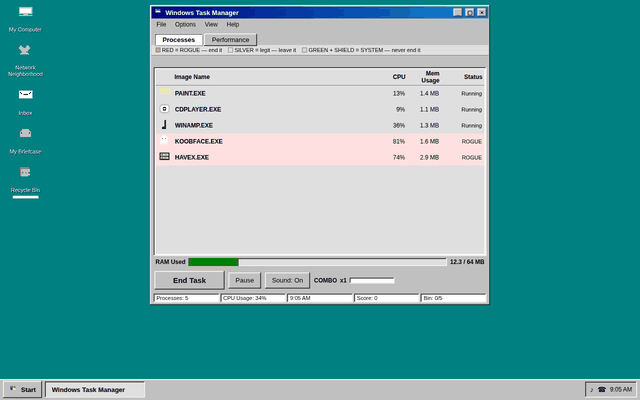
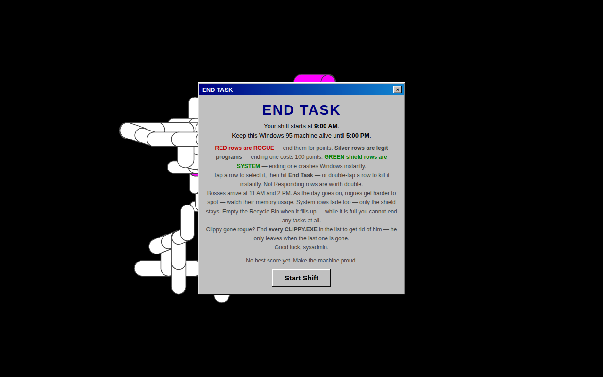
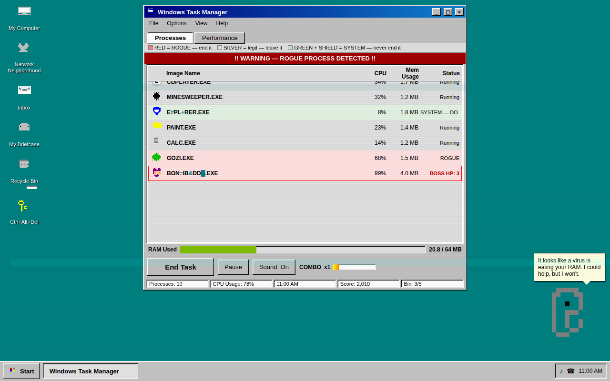
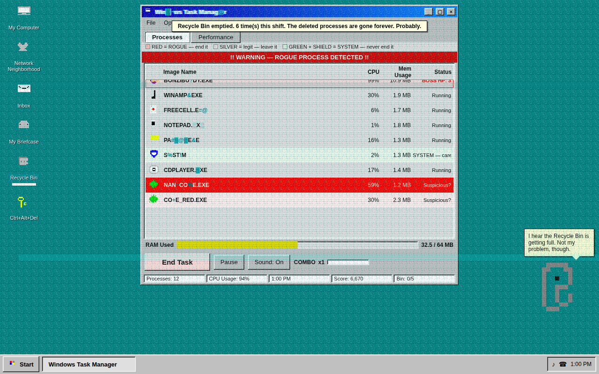
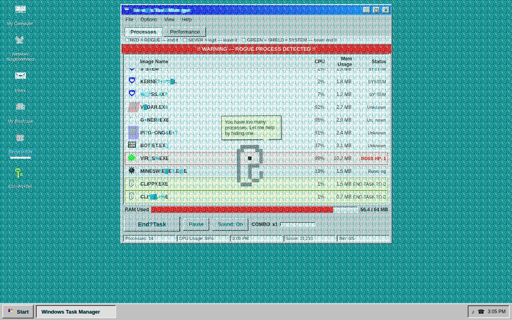
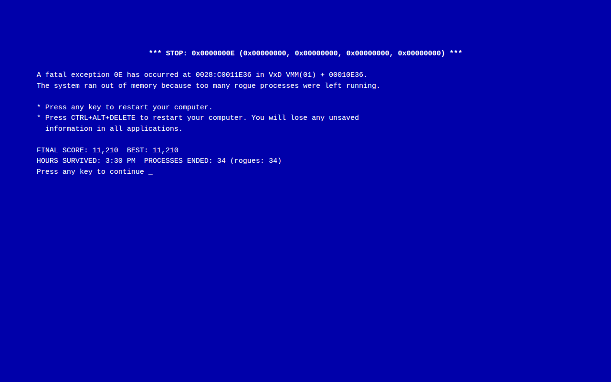

# End Task

It's 9 AM on a Windows 95 machine, and something is very wrong with it. Keep it alive until 5 PM — if you can.

## How to play

You are the IT person. The Task Manager is open, the clock is ticking, and the machine is filling up with trouble.

- **Red rows are ROGUE** — end them for points. Double points if they're Not Responding, and chain kills for a combo up to x8.
- **Silver rows are legit programs** — ending one costs you 100 points. Oops.
- **Green shield rows are SYSTEM** — end one and Windows crashes instantly. Don't.
- **RAM is your health.** When it hits 64 MB, it's a blue screen and you're fired.
- **Empty the Recycle Bin** when it fills up, or you can't end anything at all.
- **Bosses show up at 11 AM and 2 PM.** They're big, they're angry, and they bring friends.
- **Clippy turns hostile in the afternoon.** He floats over your work and hides your rows — the only way to get rid of him is to end every CLIPPY.EXE row in the list.
- **Rogues get harder to spot as the day goes on.** Their highlighting fades, some wear legit names — but a rogue's memory always climbs, and a legit program's never does. Watch the numbers.
- **Ctrl+Alt+Del** clears out rogues only. Save it for a bad moment.

Survive to 5 PM and earn your Performance Review.

## Controls

Tap a row to select it, then hit **End Task** — or just double-tap a row to kill it on the spot.

## Play

**https://retroromrunner.github.io/end-task/**

## Screenshots

*The shift starts. The pipes are already flowing.*

*A boss at 11 AM — and Clippy, floating in the way as usual.*

*Past 1 PM, the machine starts falling apart. So does the screen.*

*3 PM. RAM is in the red, names are garbled, and the rogues won't stop coming.*

*You have been fired.*

Made with AI assistance.
